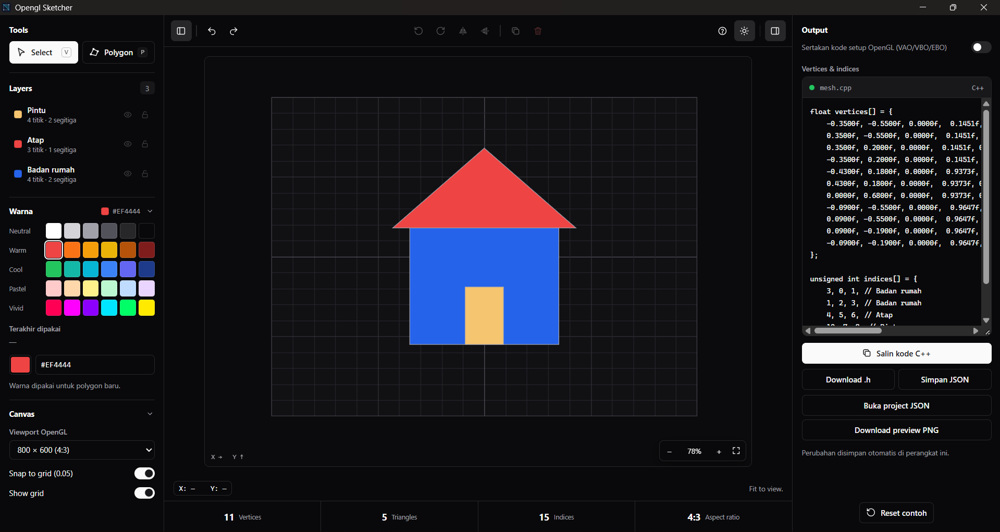

# OpenGL Sketcher

A simple 2D polygon editor for creating geometry and generating vertices and indices data for OpenGL.

## Features
- Create and edit 2D polygons (convex and concave, ear-clipping triangulation)
- Multi-selection (Shift+click, marquee, Ctrl+A), copy / cut / paste / duplicate
- Move, nudge, rotate, resize, flip, align and distribute — every result is validated
- Zoom (25%–800%, cursor-anchored) and pan, fit to view
- Layers with visibility, lock, grouping and ordering
- Colour palette with HEX input and recent colours
- Undo / redo for every document change (80 steps)
- Generate C++ vertices and indices, export a `.h` header
- Export and import JSON projects, export PNG previews
- Dark / light theme, collapsible panels, first-launch guide

## Running

- Browser: open `web/index.html` directly (no server or build step needed).
- Desktop: `npm run dev` (Tauri 2, requires Rust).
- Tests: `npm test` (Node 20+, no dependencies).

## Keyboard shortcuts

| Shortcut | Action |
|---|---|
| `V` / `P` | Select tool / Polygon tool |
| `Enter` / `Esc` | Finish polygon / cancel, deselect |
| `Delete`, `Backspace` | Delete selection (removes last draft point while drawing) |
| `Ctrl/⌘ C`, `X`, `V` | Copy, cut, paste objects |
| `Ctrl/⌘ D` | Duplicate |
| `Ctrl/⌘ A` | Select all (visible, unlocked) |
| `Ctrl/⌘ Z` | Undo |
| `Ctrl/⌘ Shift Z`, `Ctrl Y` | Redo |
| `Ctrl/⌘ G`, `Ctrl/⌘ Shift G` | Group, ungroup |
| Arrows (`Shift`) | Nudge 0.01 (0.1) NDC; nudges the selected vertex if one is active |
| `Ctrl/⌘ +`, `−`, `0` | Zoom in, out, reset to 100% |
| `Shift 1` | Fit to view |
| Scroll | Zoom at cursor |
| `Space` + drag, middle mouse | Pan |
| `Shift` while rotating / resizing | Snap 15° / keep aspect ratio |
| `?` | Shortcut list |

Shortcuts are ignored while typing in a text field, so native text editing (including Ctrl+Z, Ctrl+C, Backspace) keeps working there.

## Notes on geometry

- Model coordinates are OpenGL NDC (−1…+1). Zoom and pan are display-only and never affect coordinates, history, or any export.
- Exported triangles are always counter-clockwise, including after flips (the triangulator normalises winding; vertex order is preserved).
- UVs are a planar projection of each polygon's bounding box.
- Rotation is performed in viewport-pixel space (aspect ratio of the selected OpenGL viewport), so shapes keep their on-screen proportions.
- Hidden layers are excluded from the C++/header and PNG exports (the export panel shows a note when any are hidden) but are kept in JSON projects.
- JSON projects stay `meshsketch-v1`; the optional `hidden`, `locked` and `groupId` fields are new, and older files load unchanged.
